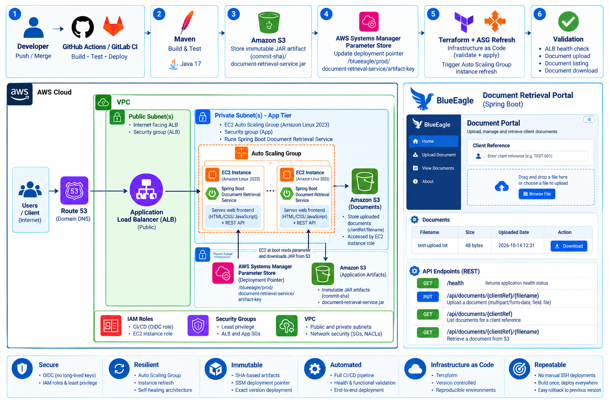

# BlueEagle Document Retrieval Service

A Spring Boot application deployed on AWS using **Terraform, GitLab CI/CD, GitHub Actions, AWS OIDC, Amazon S3, SSM Parameter Store, EC2 Auto Scaling, and an Application Load Balancer**.

This project demonstrates a build-once, deploy-exact-artifact delivery pattern, immutable application artifacts, automated infrastructure provisioning, and end-to-end application validation.

> **Project status:** The application is deployed and has passed health, frontend, document upload, listing, and download tests through the ALB. HTTPS configuration is pending availability of a company domain. Authentication and client-level authorization remain future security improvements.

## Table of Contents

<!-- TOC: Regenerate this section when headings change using a Markdown TOC generator. -->

- [Overview](#overview)
- [Architecture](#architecture)
- [Application Features](#application-features)
- [API Reference](#api-reference)
- [CI/CD Pipeline](#cicd-pipeline)
- [Immutable Artifact Deployment](#immutable-artifact-deployment)
- [Security](#security)
- [Infrastructure](#infrastructure)
- [Deployment Flow](#deployment-flow)
- [Validation and Test Results](#validation-and-test-results)
- [Repository Structure](#repository-structure)
- [Local Development](#local-development)
- [Troubleshooting and Lessons Learned](#troubleshooting-and-lessons-learned)
- [Documentation](#documentation)
- [Cleanup](#cleanup)
- [Future Improvements](#future-improvements)
- [Key Engineering Outcomes](#key-engineering-outcomes)

---

## Overview

The Document Retrieval Service is a Spring Boot application running in the application tier of an AWS platform engineering implementation.

The application provides a browser-based document portal backed by Amazon S3. Users can upload documents, list documents associated with a client reference, and retrieve previously uploaded documents.

### Technology Stack

| Component | Technology |
|---|---|
| Application | Java 17, Spring Boot 3.3.4 |
| Build | Maven |
| Frontend | HTML, CSS, JavaScript |
| Object storage | Amazon S3 |
| Infrastructure as Code | Terraform |
| CI/CD | GitHub Actions and GitLab CI/CD |
| CI authentication | AWS IAM OIDC federation |
| Deployment pointer | AWS Systems Manager Parameter Store |
| Compute | Amazon EC2, Launch Template, Auto Scaling Group |
| Traffic management | Application Load Balancer |
| Application process management | systemd |

## Architecture



All AWS infrastructure is managed through Terraform. The application runs on EC2 instances behind an Application Load Balancer, while Amazon S3 stores uploaded documents and versioned application artifacts.

The deployment process uses SSM Parameter Store to identify the exact JAR that new EC2 instances must download.

### Application Request Flow

```text
Browser
   |
   v
Application Load Balancer
   |
   v
EC2 Auto Scaling Group
   |
   v
Spring Boot Application
   |
   v
Amazon S3
   |
   v
Document Objects
```

### Application Delivery Flow

```text
Git Commit
    |
    v
CI/CD Pipeline
    |
    v
Build JAR
    |
    v
Immutable S3 Artifact
    |
    v
SSM Deployment Pointer
    |
    v
EC2 Bootstrap
    |
    v
systemd Application Service
    |
    v
ALB Health Validation
```

## Application Features

- Browser-based document portal served by Spring Boot.
- Multipart document upload.
- Document listing by client reference.
- Document retrieval from Amazon S3.
- Health endpoint for application and load balancer checks.
- AWS SDK credential resolution through `DefaultCredentialsProvider`.
- systemd-managed application lifecycle.
- Deployment through immutable JAR artifacts rather than building the application on EC2.

The application does not require a relational database or message queue. Amazon S3 is used for document storage.

## API Reference

The application exposes the following endpoints.

| Method | Endpoint | Purpose |
|---|---|---|
| `GET` | `/health` | Returns application health status |
| `PUT` | `/api/documents/{clientRef}/{filename}` | Uploads a document |
| `GET` | `/api/documents/{clientRef}` | Lists documents for a client reference |
| `GET` | `/api/documents/{clientRef}/{filename}` | Retrieves a document |

### Health Check

```bash
curl -i http://localhost:8080/health
```

Expected response:

```text
HTTP/1.1 200
OK
```

### Upload a Document

The upload endpoint expects a multipart form field named `file`.

```bash
curl -i -X PUT \
  "http://localhost:8080/api/documents/TEST-001/test-upload.txt" \
  -F "file=@test-upload.txt"
```

The application stores the document using this S3 key pattern:

```text
{clientRef}/{filename}
```

Example:

```text
TEST-001/test-upload.txt
```

A successful upload returns HTTP `201 Created`.

### List Documents

```bash
curl -i \
  "http://localhost:8080/api/documents/TEST-001"
```

A successful request returns HTTP `200 OK` and a JSON list of documents, including their filenames, sizes, and modification timestamps.

### Retrieve a Document

```bash
curl -f \
  "http://localhost:8080/api/documents/TEST-001/test-upload.txt" \
  -o downloaded-test.txt
```

Verify the downloaded contents:

```bash
cat downloaded-test.txt
```

Use synthetic documents for testing. Do not upload real customer KYC documents to this demonstration application.

## CI/CD Pipeline

The repository contains GitHub Actions and GitLab CI/CD implementations of the application delivery workflow.

The pipeline is designed to separate application artifact creation from infrastructure provisioning and application rollout.

### Pipeline Stages

```text
Test
  |
  v
Build
  |
  v
Publish Immutable Artifact
  |
  v
Terraform Infrastructure
  |
  v
Update SSM Deployment Pointer
  |
  v
Auto Scaling Instance Refresh
  |
  v
Wait for Refresh
  |
  v
ALB Health Validation
  |
  v
Application Endpoint Validation
```

The deployment workflow avoids building the application independently on every EC2 instance. The pipeline creates the JAR, publishes it to S3, and uses the SSM pointer to select the artifact for deployment.

## Immutable Artifact Deployment

Application artifacts are stored using the Git commit SHA.

### Artifact Location

```text
s3://blueeagle-prod-app-doc-artifacts/
└── document-retrieval-service/
    └── <git-sha>/
        └── document-retrieval-service.jar
```

### SSM Deployment Pointer

The deployment pointer is stored at:

```text
/blueeagle/prod/document-retrieval-service/artifact-key
```

Its value identifies the exact artifact key, for example:

```text
document-retrieval-service/<git-sha>/document-retrieval-service.jar
```

### EC2 Bootstrap Process

During instance initialization:

1. Install Java 17 and the AWS CLI.
2. Retrieve the artifact key from SSM Parameter Store.
3. Download the JAR from the artifact bucket.
4. Create the systemd service configuration.
5. Start the application.
6. Check the local application health endpoint.

This approach provides:

- Immutable, commit-specific artifacts.
- Repeatable application deployments.
- Separation of artifact publication from instance initialization.
- Easier version identification and rollback.
- Reduced dependence on source repositories during instance startup.

## Security

### CI/CD OIDC Federation

GitHub Actions and GitLab CI/CD authenticate to AWS using OIDC federation.

The intended workflow exchanges a CI platform identity token with AWS STS for temporary credentials, avoiding long-lived AWS access keys in CI/CD configuration.

```text
GitHub Actions / GitLab CI/CD
             |
             v
       OIDC Identity Token
             |
             v
      AWS IAM OIDC Provider
             |
             v
     STS AssumeRoleWithWebIdentity
             |
             v
      Temporary AWS Credentials
```

The permissions granted to each CI role should be restricted to the operations required by that pipeline.

### EC2 IAM Role

The EC2 instance role provides access to the resources required by the application and bootstrap process.

The intended permission separation is:

- Artifact bucket: read the application JAR.
- Document bucket: upload, list, and retrieve document objects.
- SSM Parameter Store: read the deployment pointer.
- Systems Manager: manage the instance when required.

The role should not use broad administrator permissions.

### Transport Security

The current ALB endpoint uses HTTP. HTTPS is a planned improvement requiring a domain controlled by the organization and a trusted TLS certificate, such as one issued through AWS Certificate Manager.

The intended configuration is:

- HTTPS listener on port 443.
- ACM certificate associated with the ALB.
- HTTP listener on port 80 redirecting to HTTPS.
- DNS record pointing the company hostname to the ALB.

### Application Security Limitations

This project is a demonstration of AWS application delivery and platform engineering patterns. It should not be considered production-ready for real KYC documents until authentication, client-level authorization, and other required security controls are implemented and tested.

An unprotected client reference must not be treated as proof of identity or authorization.

## Infrastructure

Terraform manages the AWS infrastructure required to run the application.

Components include:

- Amazon VPC.
- Public and private subnets.
- Application Load Balancer.
- Target group.
- EC2 Launch Template.
- Auto Scaling Group.
- EC2 IAM role and instance profile.
- Amazon S3 artifact bucket.
- Amazon S3 document bucket.
- AWS Systems Manager Parameter Store.
- Security groups.

The application runs on port `8080`, while the ALB exposes the application through its listener and forwards requests to the target group.

The Auto Scaling Group uses load balancer health checks to support instance replacement when targets become unhealthy.

### S3 Buckets

| Bucket | Purpose |
|---|---|
| `blueeagle-prod-app-doc-artifacts` | Stores immutable application JAR artifacts |
| `blueeagle-prod-app-documents` | Stores uploaded documents |

Keep artifact storage separate from document storage so that deployment and application data permissions can be managed independently.

## Deployment Flow

When a new application version is released:

1. CI/CD runs the configured checks and tests.
2. Maven builds the application JAR.
3. The pipeline publishes the JAR under its Git commit SHA.
4. Terraform provisions or updates the infrastructure as required.
5. The SSM deployment pointer is updated to identify the artifact.
6. The Auto Scaling Group performs an instance refresh.
7. New instances execute the Launch Template user data.
8. The bootstrap script reads the SSM pointer.
9. The instance downloads the exact JAR from S3.
10. systemd starts the application.
11. The instance registers with the ALB target group.
12. Health checks validate application availability.
13. The pipeline validates the health and application endpoints.

The bootstrap process does not need to clone the source repository or build the application on EC2.

## Validation and Test Results

The deployment was tested locally and through the live ALB.

### Local Validation

| Test | Result |
|---|---|
| Application health | HTTP 200 |
| Document upload | HTTP 201 |
| Document listing | HTTP 200 |
| Document download | Passed |
| Downloaded content verification | Passed |

### AWS Validation

| Test | Result |
|---|---|
| ALB health endpoint | HTTP 200 |
| Frontend page | HTTP 200 |
| Document upload through ALB | HTTP 201 |
| Document listing through ALB | HTTP 200 |
| Document download through ALB | Passed |
| Auto Scaling instance | InService and healthy |
| ALB target group | Healthy |

These results confirm the tested request path:

```text
Browser or API Client
        |
        v
Application Load Balancer
        |
        v
EC2 Instance
        |
        v
Spring Boot Application
        |
        v
Amazon S3
```

The deployment was also used to diagnose and resolve a bootstrap failure caused by an inaccessible application artifact. The artifact was published to the correct S3 bucket, the SSM pointer was updated, and a replacement instance was launched successfully.

## Repository Structure

```text
document-retrieval-service/
├── .github/
│   └── workflows/
│       └── deploy.yml
├── .gitlab-ci.yml
├── docs/
│   ├── architecture.md
│   ├── deployment.md
│   ├── troubleshooting.md
│   └── lessons-learned.md
├── scripts/
│   ├── user-data.sh
│   └── docservice.service
├── src/
│   └── main/
│       └── resources/
│           └── static/
├── terraform/
│   ├── bootstrap/
│   └── infrastructure/
├── pom.xml
└── README.md
```

The tree represents the intended project organization; adjust it if the actual repository differs.

## Local Development

### Prerequisites

- Java 17 or a compatible JDK.
- Maven.
- AWS CLI.
- AWS credentials with the permissions required for the test bucket.

### Build

```bash
mvn clean package
```

### Run Locally

Set the AWS region and document bucket, then launch the packaged JAR:

```bash
AWS_REGION=us-east-1 \
S3_BUCKET_NAME=blueeagle-prod-app-documents \
java -jar target/document-retrieval-service.jar
```

On Windows, use Git Bash or adapt environment-variable syntax to your shell.

The AWS SDK `DefaultCredentialsProvider` can resolve credentials from the local development environment. In AWS, the EC2 instance role supplies credentials without embedding access keys in the application.

### Test Locally

```bash
curl -i http://localhost:8080/health
```

Create a harmless test file:

```bash
echo "Local document retrieval test" > test-upload.txt
```

Upload it:

```bash
curl -i -X PUT \
  "http://localhost:8080/api/documents/TEST-LOCAL-001/test-upload.txt" \
  -F "file=@test-upload.txt"
```

List and download it:

```bash
curl -i \
  "http://localhost:8080/api/documents/TEST-LOCAL-001"
```

```bash
curl -f \
  "http://localhost:8080/api/documents/TEST-LOCAL-001/test-upload.txt" \
  -o downloaded-test.txt
```

Use an AWS identity with appropriate access to the document bucket. Local AWS permissions are separate from the EC2 instance role.

## Troubleshooting and Lessons Learned

### EC2 Instance Fails to Start the Application

Inspect the bootstrap log and systemd status:

```bash
sudo tail -n 100 /var/log/docservice-user-data.log
sudo systemctl status docservice --no-pager -l
sudo journalctl -u docservice -n 100 --no-pager
```

If the service unit does not exist, bootstrap may have stopped before creating it.

### S3 Artifact Download Returns 403

Verify the following:

1. The JAR exists in the artifact bucket.
2. The SSM pointer contains the correct artifact key.
3. The EC2 role can read the object from the artifact bucket.
4. The bucket policy and encryption configuration permit the request.

A successful SSM lookup does not prove that S3 access is permitted.

### Git Bash and SSM Parameter Names

On Windows Git Bash, arguments beginning with `/` can be rewritten as Windows paths. If AWS CLI rejects a valid SSM parameter name, try disabling MSYS path conversion for that command:

```bash
MSYS_NO_PATHCONV=1 aws ssm get-parameter \
  --name "/blueeagle/prod/document-retrieval-service/artifact-key" \
  --region us-east-1
```

### ALB Returns 502

Check target health and confirm that the application is running on port `8080`.

```bash
aws elbv2 describe-target-health \
  --target-group-arn YOUR_TARGET_GROUP_ARN \
  --region us-east-1
```

A healthy EC2 instance does not necessarily mean the application process is healthy. Inspect the service logs and bootstrap output.

### Lessons Learned

- Publish the application artifact before updating the deployment pointer.
- Update SSM before starting an instance refresh.
- Verify IAM access independently for artifact retrieval and document operations.
- Keep the artifact bucket separate from the document bucket.
- Confirm target health and application health rather than relying only on EC2 instance status.
- Preserve bootstrap logs to make failed deployments easier to diagnose.

## Documentation

Additional project documentation is available under [`docs/`](docs/):

- [`architecture.md`](docs/architecture.md) — architecture and component design.
- [`deployment.md`](docs/deployment.md) — CI/CD and deployment workflow.
- [`troubleshooting.md`](docs/troubleshooting.md) — common deployment and runtime issues.
- [`lessons-learned.md`](docs/lessons-learned.md) — engineering lessons and design decisions.

## Cleanup

Infrastructure cleanup should be deliberate and separate from the normal application deployment workflow.

Review the Terraform workspace and state before destroying resources:

```bash
terraform -chdir=terraform/infrastructure plan -destroy
```

If the plan is correct and you intend to remove the infrastructure:

```bash
terraform -chdir=terraform/infrastructure destroy
```

Bootstrap resources may be managed through a separate Terraform root and should be reviewed separately. Destroying infrastructure does not necessarily delete objects stored in S3 or other retained resources; check resource retention and data-removal requirements explicitly.

## Future Improvements

- Configure HTTPS with an ACM certificate and a company-owned domain.
- Redirect HTTP requests to HTTPS.
- Implement authentication and client-level authorization.
- Add automated unit and integration tests.
- Add security and dependency scanning to CI/CD.
- Review S3 encryption, lifecycle policies, logging, and retention requirements.
- Review least-privilege IAM permissions and production security requirements.

## Key Engineering Outcomes

This project demonstrates:

- Infrastructure as Code with Terraform.
- GitHub Actions and GitLab CI/CD.
- OIDC federation and temporary AWS credentials.
- Immutable SHA-based application artifacts.
- SSM-based deployment pointers.
- Automated EC2 instance initialization using a versioned JAR.
- Auto Scaling instance refreshes.
- Application Load Balancer health validation.
- End-to-end document upload, listing, and download.
- Troubleshooting of real deployment failures involving S3 access, SSM parameters, and EC2 bootstrap.
- Separation of infrastructure provisioning from application version deployment.
